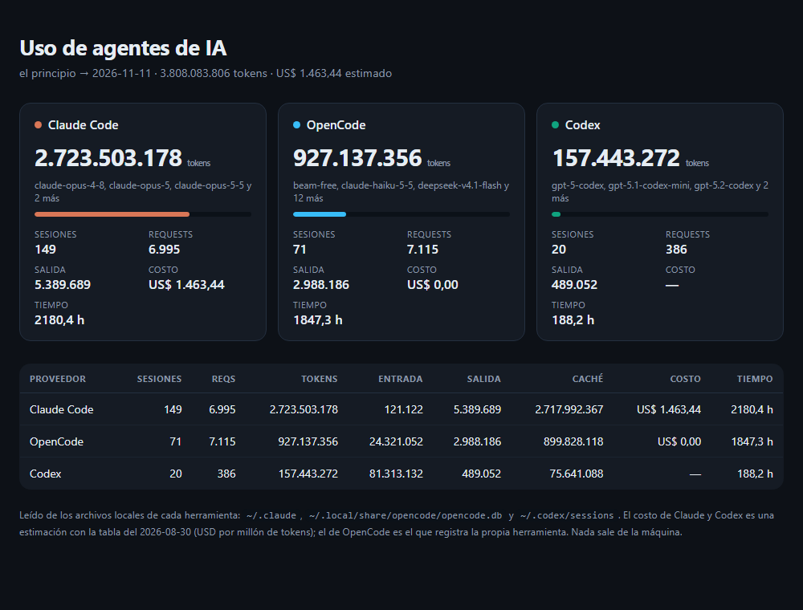

# agent-usage-cli

<p align="center">
  <a href="https://github.com/lucabaello1998/agent-usage-cli/releases/latest"></a>
</p>

**Tu uso de agentes de IA en la terminal, en un comando.** Lee los archivos que dejan
Claude Code, OpenCode y Codex, y devuelve sesiones, tokens, costo y tiempo en una tabla, un
CSV o un informe HTML autocontenido. Sin dependencias, sin red, sin telemetría.

```bash
$ agent-usage
PROVEEDOR    SESIONES   REQS         TOKENS     ENTRADA     SALIDA          CACHÉ            COSTO
-----------  --------  -----     ----------  ----------  ---------  -------------  ---------------
Claude Code       149  6.995  2.723.503.178     121.122  5.389.689  2.717.992.367  >= US$ 1.463,44
OpenCode           71  7.111    927.137.356  24.321.052  2.988.186    899.828.118         US$ 0,00
Codex              20    386    157.443.272  81.313.132    489.052     75.641.088                —
```



## Por qué

[OpenCockpit](https://github.com/lucabaello1998/OpenCockpit) es la versión con ventana: sirve para mirar,
pero no para un `cron`, un CI o un SSH. Esto es lo mismo en la terminal: entra en un script, se pega en
un ticket y no necesita Electron.

## Instalar

```bash
pipx install git+https://github.com/lucabaello1998/agent-usage-cli

# o desde el repo
git clone https://github.com/lucabaello1998/agent-usage-cli
cd agent-usage-cli
pip install -e .
```

Python 3.10+. No hay dependencias.

## Uso

```bash
agent-usage                          # últimos 7 días
agent-usage --desde 24h              # hoy
agent-usage --desde 30d --detalle    # con el listado de sesiones
agent-usage --desde todo             # todo el histórico
agent-usage --proveedor opencode     # una sola herramienta

agent-usage --csv uso.csv            # para Excel (UTF-8 con BOM)
agent-usage --html informe.html      # informe para compartir
agent-usage --json                   # para pipear a jq
```

`--desde` acepta `24h`, `7d`, `30d`, `todo` o una fecha `AAAA-MM-DD`.

## Qué mide (y qué no)

Cada herramienta guarda cosas distintas. El CLI muestra lo que hay y deja en `—` lo que no, en vez de
inventar un cero:

| | Claude Code | OpenCode | Codex |
|---|---|---|---|
| Tokens (entrada / salida / caché) | sí, por request | sí, por sesión | sí, acumulados por sesión |
| Requests | sí (deduplicados por `requestId`) | sí (mensajes `assistant`) | sí (mensajes `assistant`) |
| Costo | **estimado** con tabla de precios | **el que registra la herramienta** | estimado, si el modelo está en la tabla |
| Tiempo | duración de la sesión (primera a última actividad) | desde que se creó hasta la última vez que estuvo ocupada | duración de la sesión |
| Latencia por request | **no existe** en los logs | **no existe** | **no existe** |

Sobre el costo: con suscripción, Claude Code no factura por token, así que el número es para comparar
sesiones y modelos, no una factura. Los precios son una foto (`2026-08-30`) y se pueden reemplazar:

```bash
agent-usage --precios mis-precios.json
```

```json
{ "modelos": { "claude-sonnet-5": { "input": 2, "output": 10, "read": 0.2, "write5m": 2.5 } } }
```

Un modelo desconocido no cuesta `US$ 0,00`: la tabla lo marca con `—` y el total se muestra como
`>= US$ X` cuando falta alguno.

## De dónde lee

| Herramienta | Ruta |
|---|---|
| Claude Code | `~/.claude/projects/**/*.jsonl` |
| OpenCode | `~/.local/share/opencode/opencode.db` (SQLite, **solo lectura**) |
| Codex | `~/.codex/sessions/**/*.jsonl` |

Respeta `CLAUDE_CONFIG_DIR`, `OPENCODE_DATA_DIR` y `CODEX_HOME` si los tenés configurados. Si una
carpeta no existe, esa fuente simplemente no aporta.

## Cómo está armado

```
agent_usage/
  fuentes.py   lectores de las tres herramientas (JSONL y SQLite)
  modelo.py    Uso (una sesión) y Agregado (por proveedor)
  precios.py   tabla de precios + costo por tokens
  reporte.py   tabla de consola, CSV, JSON y HTML
  cli.py       argumentos, filtros de período y salidas
tests/         23 tests con fixtures que copian el formato real
```

La base de OpenCode se abre en modo `mode=ro` y con URI: un dashboard no puede dejar un lock ni tocar
el archivo de otra herramienta.

## Tests

```bash
python -m pytest -q     # 23 passed
ruff check . && ruff format --check .
```

Los tests no dependen de la máquina: arman un HOME de mentira con un JSONL de Claude, un SQLite de
OpenCode y un rollout de Codex, con el formato real de cada uno. El CI los corre en Python 3.10 y 3.12.

## Límites

- No hay latencia por request porque ninguna de las tres la guarda; se muestra duración y ritmo.
- El costo de Claude es una estimación con una tabla que envejece.
- Lee lo que hay en disco: si borraste los logs, no hay historia.

## Publicar en PyPI

Todavía no está en PyPI: se instala desde el repo (ver *Instalar*). Para publicarlo:

```bash
python -m build
python -m twine upload dist/*
```

Hace falta una cuenta en PyPI y un token en `~/.pypirc` o en la variable `TWINE_PASSWORD`; no hay
secretos en el repo. El CI construye el paquete en cada push para que el `pyproject.toml` no se rompa.

## Licencia

MIT. Ver [`LICENSE`](LICENSE).
